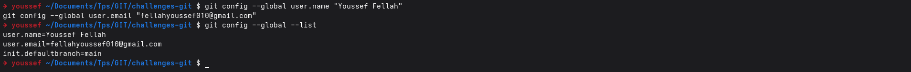
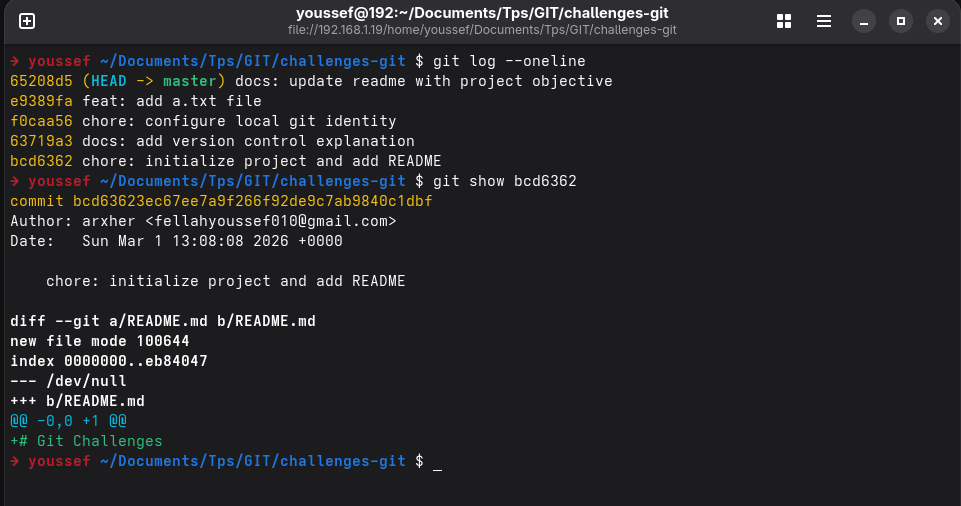
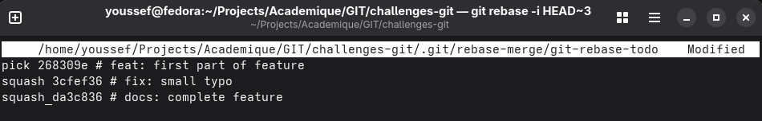
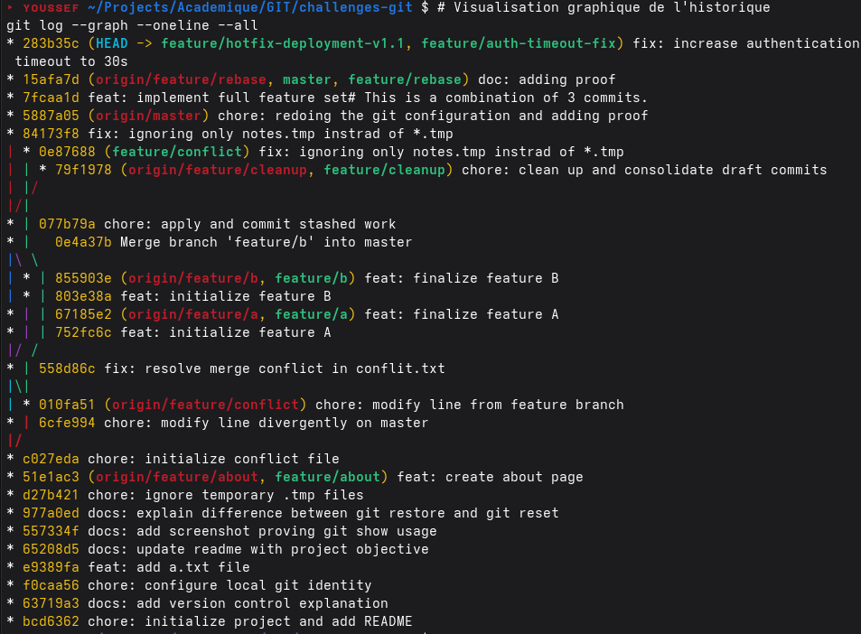

# Git Advanced Workflows & Maintenance Laboratory

A comprehensive exploration of the Git ecosystem, focused on mastering professional version control strategies, conflict resolution, and responsible AI integration. This project serves as a technical deep-dive into advanced Git operations and repository maintenance.

## Project Architecture

The laboratory demonstrates a professional development lifecycle through controlled branch management:

1.  **Feature Tier**: Isolated development using the **Feature Branching** pattern for new functionalities and documentation.
2.  **Maintenance Tier**: Implementation of **Hotfixes** and **Cherry-picking** for critical production-ready patches.
3.  **Integration Tier**: Advanced merge strategies including **Rebase** and manual **Conflict Resolution** for diverging codebases.
4.  **Traceability Tier**: **Human-in-the-loop** AI integration with documented review processes for generated code.

---

## Technical Stack

*   **Version Control**: Git (Advanced Workflows)
*   **Operating System**: Fedora 43
*   **Scripting**: Python (Configuration Validation)
*   **Documentation**: Markdown (Technical & AI Review)
*   **Platform**: GitHub (Collaborative Maintenance)

---

## Interface Showcase (Git Operations)

| Branch Management | Conflict Resolution |
| --- | --- |
|  |  |

| Maintenance Workflow | AI Traceability |
| --- | --- |
|  |  |

---

## Core Implementations

### 1. Advanced Branching Strategies
*   **Feature Isolation**: Strict adherence to branching naming conventions for distinct development tracks.
*   **Maintenance Workflows**: Demonstration of `git cherry-pick` and `git tag` for versioned releases.
*   **Strategic Rebasing**: Maintaining linear history while integrating upstream changes.

### 2. Manual Conflict Resolution
*   **Divergence Analysis**: Handling complex merge conflicts in critical configuration and documentation files.
*   **Resolution Integrity**: Ensuring structural and functional correctness after manual intervention.

### 3. Responsible AI Integration
*   **AI-Assisted Development**: Utilizing AI for code generation (`config_validator.py`) with strict traceability.
*   **Human Audit**: Documented manual review process (`ai-review.md`) to distinguish AI suggestions from human logic.

---

## Project Structure

```text
├── docs/
│   ├── ai-review.md       # AI traceability & human-in-the-loop audit
│   ├── version-control.md # Technical notes on Git principles
│   ├── undo.md            # Strategies for reversing operations
│   └── about.md           # Project context and objectives
├── screenshots/           # Visual proofs of Git operations
├── config_validator.py    # AI-assisted Python utility
├── config.txt             # Sample configuration for validation
├── LICENSE                # MIT License
└── README.md              # Project documentation
```

---

## Deployment & Setup

### Prerequisites
*   Git 2.40+
*   Python 3.10+

### Launch Sequence
1.  **Clone the repository**:
    ```bash
    git clone git@github.com:yss-ef/Challenges-Versioning-Maintenance-Refactoring.git
    ```
2.  **Explore History**:
    ```bash
    git log --graph --oneline --all
    ```
3.  **Run Validator**:
    ```bash
    python3 config_validator.py
    ```

---

*Authored by Youssef Fellah.*

*Developed for the 2nd year Engineering Cycle - Mundiapolis University.*
